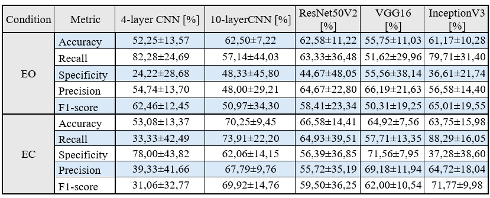
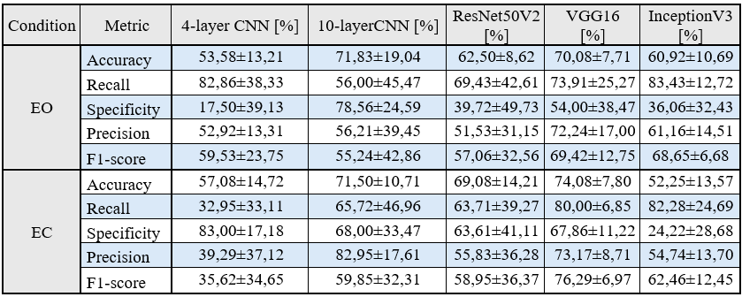
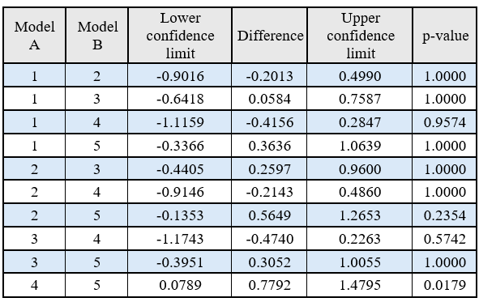

# ADHD Classification Using Convolutional Neural Networks Based on EEG Spectrograms

## Projcet overview

The objective of this project is to evaluate whether convolutional neural networks (CNNs) can distinguish adults with ADHD from healthy controls using time-frequency representations of EEG signals.

The project uses Short-Time Fourier Transform (STFT) spectrograms as image inputs to deep learning models.

The experiments investigate two main factors:

- **EEG channel configuration:** spectrograms generated from 19 channels or a selected 4 channels.
- **Recording condition:** EEG signals recorded with eyes open (EO) or eyes closed (EC).

Five CNN architectures are evaluated compare their classification performance:

* **custom 4-layer CNN**
* **custom 10-layer CNN**
* **ResNet50V2**
* **InceptionV3**
* **VGG16**

## Dataset

The experiments use EEG recordings from the [TDBrain database](https://brainclinics.com/resources/tdbrain-dataset), which contains EEG data from individuals with different neuropsychiatric conditions and healthy controls.

The project uses a subset consisting of healthy adults and patients with ADHD older than 21.

| Property | Description |
| --- | --- |
| Dataset | TDBrain |
| Total participants | 77 |
| ADHD group | 40 participants |
| Control group | 37 participants |
| Recording conditions | Eyes Open (EO), Eyes Closed (EC) |
| Original EEG channels | 26 |
| Channels used in the experiments | 19 or 4 |

## Methodology

Each two-minute recording is divided into twelve non-overlapping segments of 10 seconds. Each segment is represented by a spectrogram, resulting in 924 samples per recording condition and channel configuration.

### EEG Preprocessing

The EEG recordings were preprocessed before being used in the experiments. The preprocessing pipeline included:

- Independent Component Analysis (ICA) for artifact removal.
- Laplacian reference for spatial filtering.
- Band-pass filtering between 0.5 Hz and 40 Hz.
- Notch filtering at 50 Hz to suppress power-line interference.
- Segmentation into 10-second intervals.

### Spectrogram Generation

Each EEG segment is transformed into a time-frequency representation using the Short-Time Fourier Transform.

The spectrogram generation procedure uses:

- A 2-second Hamming window.
- A 90% overlap between consecutive windows.
- Averaging of spectral power across the selected EEG channels.
- Logarithmic scaling of spectral power.
- Image resizing to 224 × 224 pixels.

Two channel configurations are investigated:

- **19-channel configuration:** uses standard 10-20 electrode system.

- **4-channel configuration:** focusing on frontal and central brain regions.

Each configuration is evaluated separately for EO and EC recordings.

### CNN Architectures

Five convolutional neural network architectures are compared.

| Model | Description |
| --- | --- |
| CNN-4 | Custom CNN with four convolutional layers |
| CNN-10 | Custom CNN with ten convolutional layers |
| ResNet50V2 | Residual CNN pretrained on ImageNet |
| VGG16 | Deep CNN pretrained on ImageNet |
| InceptionV3 | CNN using Inception modules, pretrained on ImageNet |

### Training Configuration

The models are trained using TensorFlow and Keras.

| Parameter | Value |
| --- | --- |
| Optimizer | Adam |
| Learning rate | 0.00001 |
| Batch size | 16 |
| Maximum epochs | 50 |
| Cross-validation | 5-fold |
| Random seed | Fixed for reproducibility |

Binary cross-entropy is used for CNN-4, CNN-10 and VGG16. Binary focal cross-entropy is used for ResNet50V2 and InceptionV3.

### Patient-Level Evaluation

All spectrograms originating from the same participant are assigned to the same fold. This prevents recordings from a single participant from appearing in both the training and test sets.

For each participant, the model produces a probability for every spectrogram. These probabilities are averaged to obtain a single patient-level prediction. A mean probability greater than 0.5 corresponds to the ADHD class; otherwise, the participant is assigned to the control group.

## Evaluation Metrics

Model performance is assessed using the following classification metrics:

- **Accuracy:** proportion of correctly classified participants.
- **Recall:** proportion of participants with ADHD correctly identified.
- **Specificity:** proportion of control participants correctly identified.
- **Precision:** proportion of positive predictions that are correct.
- **F1-score:** harmonic mean of precision and recall.

### Statistical Analysis

The Friedman test is used to assess differences between the five architectures, using patient-level accuracy values for each configuration.

If the Friedman test indicates a statistically significant difference, post-hoc multiple comparisons with Bonferroni correction are performed.

# Results

The best overall reported result was obtained by VGG16 using spectrograms generated from four EEG channels under the eyes-closed condition.

19-channel spectrogram condition

4-channel spectrogram condition

Statistical tests showed that VGG16 performed significantly differently from InceptionV3 in the four-channel EC setup (Friedman test p = 0.0269; direct comparison p = 0.0179).

For the other three configurations, the Friedman test did not identify statistically significant differences between the evaluated architectures at the 0.05 significance level.

These findings suggest that model performance depends on both the selected EEG representation and the network architecture. However, the results do not establish that the approach is sufficiently reliable for standalone clinical diagnosis.

## Possible improvements

* **Explore additional CNN architectures**
* **Investigate alternative EEG representations**
* **Use larger datasets**